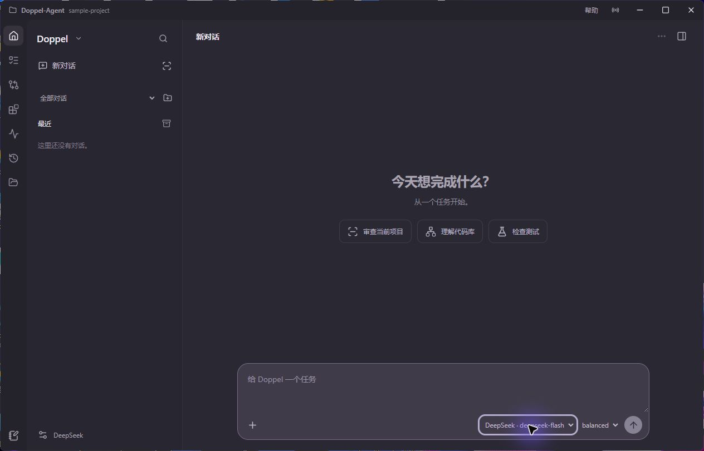
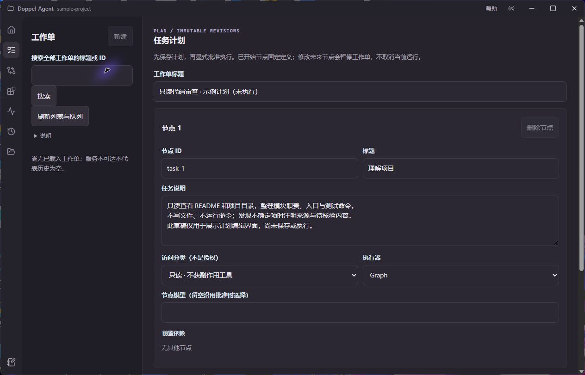

**Doppel-Agent 是一个面向 Windows 的本地编程 Agent 与编程工作台。** 它尝试把理解仓库、审查代码、编排任务、修改文件与验证结果，放到一个能保存状态、能检查过程、能明确批准副作用的本地界面中。

我关心的不是把聊天框包进 EXE，而是聊天结束以后还能回答几个问题：模型读过哪些文件？这次执行用的是什么上下文？一个任务是刚排队还是已经完成？补丁基于哪个版本？到底是谁允许了命令执行？断开连接以后，结果能不能找回来？

这些问题听起来没有“一句话开发完整应用”那么刺激，却是 Agent 从演示走向实际工作时必须面对的麻烦。

> 本文核对日期为 2026-10-12，源码版本为 `188e43d376f7`。当前公开桌面版本是 **`v0.15.0-rc.1` 预发布**，不是稳定 v1.0，也不是全部原生验收完成。下方截图来自隔离样例中的真实 EXE，但没有提交任务或模型请求；它们证明界面存在，不证明模型质量。

## 工作台里有什么？



桌面壳使用 pywebview / WebView2，界面使用 Vue 3、TypeScript 与 Vite，后端是 Python 与 FastAPI。项目状态落在选定工作区的 `.doppel-agent/` 中；一个原生窗口有一个当前项目，不会把不同项目的对话与上下文默默混成一个大池子。

| 工作区 | 提供的能力 | 不应该误解成什么 |
| --- | --- | --- |
| 对话 | 持久对话、标题与消息搜索、分组、归档、审查模板 | 新建对话不等于自动执行任务 |
| 计划与任务 | 可修订的工单、依赖、引擎与 profile、持久队列 | 保存计划不等于派发；派发需要显式审批 |
| 上下文与笔记 | 文件片段、接受的快照、有来源的事实与约束 | 面板里出现内容不等于已绑定到执行上下文 |
| 变更与验证 | 多文件 Diff、基线检查、冲突提示、审阅后执行 | 当前 Git 状态不等于历史运行生成的补丁 |
| 扩展 | MCP 配置与目录、Skills 元数据、内置工程 Skills | 打开扩展页不等于给了工具执行权限 |
| 报告 | 持久事件、工具与审批、用量和声明价格估算 | 未知用量不是零费用，估算不是账单 |

工作台追求的是“信息有位置，行为有边界”：计划、上下文、执行、文件结果分别有自己的记录，而不是所有东西都埋在聊天消息里。

## 三种引擎，不是三套互不相干的产品

项目保留 Legacy 基线、LangGraph `graph` 与可选 Deep Agents `deep` 三个引擎，在同一个异步运行契约后面提供不同执行方式。Graph 强调显式状态与恢复，Deep 使用项目自有 backend 和有界、只读的 specialist，Legacy 保留对照与兼容路径。

创建对话时会固定引擎。之后选择模型 profile 或推理 effort，不等于把旧对话直接转成另一种引擎。Deep 的 fallback 会留记录，不会失败后悄悄换路、再把结果伪装成原来那条路径的完成。

“多个引擎”也不意味着某个引擎一定更聪明。模型质量必须用同一模型、任务集、协议和成功标准比较；这里只介绍编排能力，不给出没有控制实验支撑的胜率或 Token 节省比例。

## 一次任务到底怎么流动？

```text
桌面 / 原生 API
  → RunService：身份、请求、上下文与运行记录
  → AsyncRunScheduler：有界队列与工作区锁
  → Graph / Deep / Legacy runtime
  → Provider 与受限工具
  → SQLite / Checkpoint / 持久事件
  → SSE 与 Vue 界面
```

这条路径把“接到一个请求”与“完成一个请求”分开。`POST /api/v1/runs` 返回 `202 Accepted`，表示请求被接纳，并给出 `run_id`、`thread_id` 与当前状态，**不表示代码已经改完，更不表示验证通过**。队列满时可以返回 `429`，而不是无限积压在后台。

运行状态与事件都有持久记录。事件接口支持按序号读取，也可以通过 SSE 实时接收；重连使用序号或 `Last-Event-ID` 接续，避免前端断线之后只能猜测后台是否还在工作。取消与重启协调也是独立行为：隐藏面板、切换页面，并不等于取消任务。

工程上，这是从“一个调用函数”走向“一个任务生命周期”的变化。生命周期需要处理排队、资源冲突、审批暂停、失败恢复与收尾，而这些都不应该依赖浏览器页面永远不关闭。

## 显式上下文：不要让模型猜自己看到了什么

聊天窗口里的信息、侧栏中打开的文件和实际送进运行的上下文，是三件不同的事。Doppel-Agent 使用文件片段、接受的快照与有来源的项目笔记，在请求接纳时冻结所选上下文。

冻结意味着这次运行应有可复核的输入，而不是在执行过程中随着用户切面板而改变。底层文件或笔记版本发生变化时，需要重新检查，不能仍把旧快照标成新状态。也因此，旧链路的 Legacy 历史不会自动变成原生历史，更不会自动继承原生上下文绑定。

这对代码审查尤其重要：如果结论依据的是过期文件，而界面只告诉你“审查通过”，你得到的不是安全感，只是一份过期文件的好评。

## Diff-first：先看改了什么，再决定是否产生副作用

Doppel-Agent 的文件修改以多文件差异为中心。补丁带有基线哈希检查，应用前要确认当前文件仍然匹配所审阅的版本；基线已经变动就显式冲突，而不是硬把模型生成的内容覆盖进去。

写文件、执行命令、使用 MCP 和委派分别有运行级 grant；这些 grant 也不取代单次审批。换句话说，“允许本次任务提出写入”不等于“之后所有写入都已经同意”。项目把能力授权与具体动作审批分开，避免一个宽泛的开关吞掉所有细节。

反向操作与验证同样不是无条件按钮：反向审阅依赖保留的 preimage 与新鲜状态检查；验证使用项目配置的 argv，仍需要命令 grant 和独立批准。因此，“撤销”不是保证任何历史状态都能被无损找回，“跑测试”也不是允许模型生成任意 Shell 字符串。

这并不构成强操作系统沙箱。外部命令和 MCP 程序仍以当前用户身份运行，工作区与策略约束不能替代系统级隔离。第一次体验应该在可以丢弃的项目中完成，而不是把日常唯一一份工作代码交给未知模型和工具。

## 计划、MCP 与 Skills：把扩展接进同一套边界



计划编辑器可以保存修订、定义依赖、选择引擎与 profile，并将工单派发到持久任务队列。**保存草稿不是运行证据。** 上图展示的是只读样例，不代表已经成功执行了这些任务。

扩展层支持 stdio 与 Streamable HTTP MCP 生命周期管理，以及渐进披露的 Agent Skills。目录缓存、元数据查看和实际工具调用属于不同操作：查看目录不应该偷偷启动外部服务；探测和刷新需要确认；模型知道工具名称，也不意味着拥有执行许可。

Skills 用来把工程步骤和约束组织成可按需读取的指导，但不是一套可以绕过权限的魔法脚本。它们和 MCP 一样，最终仍要落到运行级许可、单次审批与可追溯事件上。

## 在 Windows 上开始使用

最方便的入口是 GitHub 预发布页中的 Windows x64 压缩包。解压时保留整个目录：`DoppelAgent.exe` 需要与 `_internal` 并列，单独复制 EXE 并不能成为真正的便携版本。打包桌面不需要另外安装 Python，但 Windows 10+ 需要 Microsoft Edge WebView2 Runtime。

```powershell
# 在完整解压的发布目录运行；使用一个可丢弃的测试项目。
.\DoppelAgent.exe --workspace 'D:\your-project'
```

建议先选择离线 Mock，再做只读仓库理解。Mock 是确定性的工程控制，用于检查界面、事件和流程，不是一个通用编程模型。连接真实 OpenAI-compatible Chat Completions Provider 后，显式发送任务才会执行；**测试连接也可能产生计费请求**。

从源码运行需要 Python 3.11+，按项目说明安装 agent 与 desktop 可选依赖：

```powershell
git clone https://github.com/zureealLV/Doppel-Agent.git
cd Doppel-Agent
py -3.11 -m venv .venv
.\.venv\Scripts\python.exe -m pip install -e ".[agent,desktop]"
.\.venv\Scripts\python.exe -m doppel_agent desktop --workspace 'D:\your-project'
```

当前桌面默认是新的 Vue 工作台，不能和 `doppel.cmd ui` 提供的旧轻量浏览器控制台混为一谈。Standalone Runtime 是独立运行，不是既有对话的继续；单独启动 API 也不意味着同时提供完整桌面资源和 Legacy bridge。

## 当前进度与需要诚实留下的空白

预发布版已经提供这些工作台入口与实现，但完整 runtime / native 验收和付费模型质量评测仍待完成。自动化工程测试、脚本 fixture、离线矩阵与原生窗口截图，不能直接转换成代码审查成功率、节省 Token 比例或生产可靠性指标。

本版 README 还保留了发布源 main 分支 CI 通过、后续 tag CI 因 Python 3.12 集成超时失败的不同记录。它们对应不同运行，不能合并成“发布全绿”。具体状态应查看该版本的发布说明与 Actions，而不是只看文章里的日期。

目前也没有强 OS 沙箱、精确 Provider tokenizer 或完整 CLI / daemon 交互审批流。用量未知时应显示未知，声明价格估算不是正式账单；评测 runner 的预算台账更不是普通桌面对话或整个 Provider 账户的消费上限。

这些边界不是为了给项目降温，而是为了让下一步有清晰目标：先把同一任务的输入、授权、修改与验收记录完整，再谈模型实际完成了多少工作。对一个本地编程 Agent 来说，**可审阅不是“自主”的反面，而是自主行为值得信任的前提。**

## 源码与使用文档

- [GitHub 项目](https://github.com/zureealLV/Doppel-Agent) · [v0.15.0-rc.1 发布页](https://github.com/zureealLV/Doppel-Agent/releases/tag/v0.15.0-rc.1)
- [本文对应的源码版本](https://github.com/zureealLV/Doppel-Agent/tree/188e43d376f793715967e30f5a8d55a0ee929fbf)
- [RunService 运行集成点](https://github.com/zureealLV/Doppel-Agent/blob/188e43d376f793715967e30f5a8d55a0ee929fbf/src/doppel_agent/runtime/service.py)
- [Run API：202、事件、取消与恢复](https://github.com/zureealLV/Doppel-Agent/blob/188e43d376f793715967e30f5a8d55a0ee929fbf/src/doppel_agent/api/routes/runs.py)
- [使用指南](https://github.com/zureealLV/Doppel-Agent/blob/188e43d376f793715967e30f5a8d55a0ee929fbf/docs/USER_GUIDE.md) · [截图来源与限制](https://github.com/zureealLV/Doppel-Agent/blob/188e43d376f793715967e30f5a8d55a0ee929fbf/docs/images/README.md)
- [返回作品集](/portfolio/)
