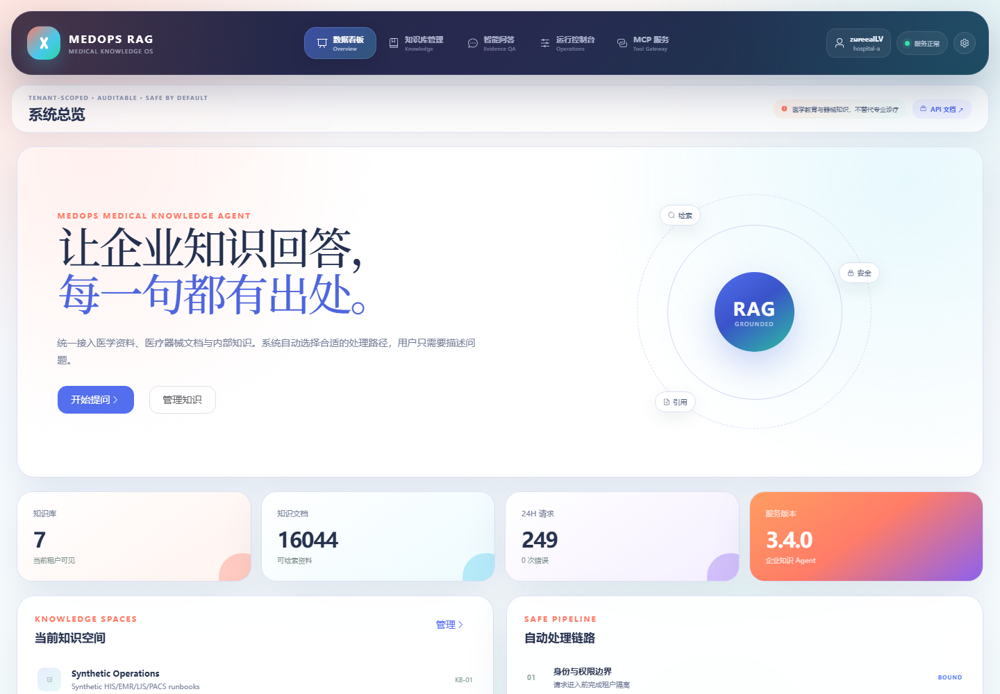

**MedOps RAG 是一个可审计、多租户的企业知识库问答 Agent。** 它把“上传资料后和模型聊天”拆成能够检查的步骤：资料如何进入知识库，问题如何找到证据，谁有权看到这些证据，答案引用能否回到原文，以及失败后该去哪里查原因。

名字里的 MedOps 来自最初的医疗公开资料验证域，但项目的默认策略是企业知识问答。制度、SOP、产品说明、客服手册和运维文档都可以成为它的知识来源；医疗资料用于检验来源追溯与高风险拒答，不意味着这是一个临床诊断系统。

这篇文章是面向第一次接触项目的**功能与上手导览**。如果你更关心算法取舍、原始评测与架构设计，可以接着阅读已有的[证据链技术长文](/posts/medops-rag-evidence-first-enterprise-knowledge-agent/)。两篇文章互相补充，不替换旧文章地址。

> 本文以 2026-10-12 核对的源码 `2fd718ad4a48` 与 V3.5 项目文档为依据。功能说明是源码和文档核验，不代表本次重新完成了生产压测、医疗安全验证或 Docker Linux 验收。

## 一眼看懂：它提供哪些能力？



| 功能区 | 可以做什么 | 工程约束 |
| --- | --- | --- |
| 知识库与文档 | 创建租户知识空间，上传与搜索资料，查看来源 | 身份在服务端解析，数据访问限制在租户范围内 |
| 文档摄取 | 解析 PDF、Office、图片与结构化文件，建立索引 | 上传与解压有预算，扫描内容经 OCR，异步任务可查 |
| 持续对话 | 新建会话、查看历史、提出追问、删除对话 | 会话按租户与使用者持久化，追问仍进入证据问答链 |
| 引用与轨迹 | 阅读编号来源卡片，查看检索和 Agent 路径 | 无足够证据时拒答，返回引用再做租户复核 |
| 管理与运行 | 查看任务、Provider、指标、检索实验配置 | 调参和模型配置属于管理员能力，不由普通用户决定 |
| MCP 接入 | 向兼容客户端开放知识库列表、检索与回答工具 | 不因换入口而绕过鉴权、审计与租户边界 |

这里最重要的不是功能数量，而是功能之间的约束：一个普通使用者不能为了让模型“更聪明”，把另一家公司资料检索出来；一次模型调用成功，也不等于引用正确；一张漂亮的对话截图，更不能代替部署安全检查。

## 第一条路径：让资料变成可检索的证据

摄取支持 TXT、Markdown、PDF、DOCX、PPTX、PNG、JPEG、WebP、CSV、JSON 与 JSONL。文本资料不只是切成字符串；项目还尽量保留页码、标题、版面坐标、来源 URL 与内容哈希，让之后的答案能够指回原始位置。

扫描 PDF 和文档内嵌图片可以走 RapidOCR / ONNX Runtime；Office 压缩容器在处理前检查危险路径、条目数量、膨胀量、压缩比与宏。图片 BLOB 在租户范围内按 SHA-256 去重。它们分别解决“扫描件没文字”“解析器被超大文件拖垮”“重复图片占空间”的不同问题，不能被一个“支持多模态”的标签糊成一团。

较重的摄取工作通过持久任务处理，具有幂等键、租约、有限重试、取消与恢复机制。因此，上传文件后应先确认任务状态与知识库内容，而不是看到上传成功就默认检索索引已完整建立。文件接收、任务完成与答案可用，是三个不同的检查点。

## 第二条路径：问题、检索、回答与引用

```text
使用者身份 + 问题
  → 租户 / 角色边界
  → 追问整理（持续对话入口）
  → 候选召回与混合检索
  → 有界 Agent / 证据回答
  → 引用范围复核
  → 答案、来源卡片与运行轨迹
```

检索使用 SQLite FTS5 候选召回，结合 BM25、RRF、可选向量与 Parent–Child 上下文恢复。BM25 擅长词法匹配；RRF 融合不同排序；Parent–Child 则尝试把命中的小片段放回足够完整的上下文。自适应路由会选择路径并给出原因，但不能理解为“所有问题都使用全部算法”，更不能保证比固定策略永远更好。

默认回答可以离线抽取，不必先购买模型调用额度。接入外部 Provider 后，模型仍然需要遵守检索证据和策略边界。输出使用可读的 `[来源N]` 编号与来源卡片，而不是把内部 chunk ID、排序分数当作最终答案给用户看。

持续对话是 V3.5 的一个实用入口。你可以先问一个主题，再问“那个呢”“还有什么限制”。实现会对口语和简短追问做规则化整理，使用首个用户问题作为主题锚点，再调用既有受控 RAG Agent。**这不是无限长记忆，也不是保证理解任意省略句的语义模型**；理解错误时，应补充完整问题并检查检索到的来源。

## 为什么把角色与租户做在模型之前？

项目中，租户限制不依赖一句“请不要泄露其他租户信息”的 Prompt。身份由服务端获得，SQL 查询先限制知识空间与文档范围，最终返回的文本、图片证据和引用再做范围复核。这样，其他租户的正文不应先进入模型上下文，再寄希望于模型自觉忘记。

普通 viewer / editor 面向业务问答，管理员才可以控制检索实验参数、测试或切换 Provider。对话历史也按 `tenant + actor` 保存；同租户下不同使用者的历史，不应仅因为拿到了一个会话标识就相互可见。

本地演示的 `trusted_headers` 便于调试，但不能直接作为公网身份方案。公网部署需要 API Key 身份模式，并在网关补齐 TLS、限流与密钥管理。提示注入检测是纵深防御的一层，不是“百分之百防注入”的承诺。安全是一组需要逐层复核的边界，不是一个绿色勾选框。

## Agent 和 MCP：开放能力，不开放任意权限

`/answer` 保留 Classic Python、LangChain LCEL 与 LangGraph 三种编排。LangGraph 路径最多选择两个代码所有、只读的白名单工具：证据回答与引用租户复核。工具名、参数和调用次数都有约束；Checkpoint 只保存必要控制元数据，避免把资料正文与密钥变成恢复状态的一部分。

`/mcp/` 提供 Streamable HTTP 接入。外部客户端能够发现和使用证据工具，但仍在同一身份与审计规则内运行。MCP 在这里是知识能力的复用接口，不是任意文件访问或执行命令的通行证。

Provider 层对外部模型调用设置总 deadline、有限重试、全局与租户容量、退避和熔断。它们解决的是慢请求、限流、过载和恢复问题，不直接证明模型的答案质量。质量仍需固定语料、问题集和成功标准来测量。

## 本地启动与一个最小体验流程

项目需要 Python 3.11+；前端需要项目文档支持的 Node.js 版本。以下是 Windows PowerShell 源码启动流程，依赖安装仅用于该项目，不是本篇博客的构建命令：

```powershell
git clone https://github.com/zureealLV/medops-rag.git
cd medops-rag
python -m venv .venv
.\.venv\Scripts\python.exe -m pip install -e ".[dev]"
.\scripts\build_frontend.ps1
.\.venv\Scripts\python.exe .\scripts\seed_sample_data.py --profile operations --tenant company-a
.\.venv\Scripts\fastapi.exe dev
```

启动后，Web 控制台在 `http://127.0.0.1:8000/`，OpenAPI 在 `/docs`，健康检查在 `/health`。本地演示默认身份使用 `X-Tenant-ID: company-a` 与 `X-Actor-ID: local-demo`；实际登录方式以当前身份配置为准。

建议从五个动作开始：**打开示例知识库 → 问一个资料明确覆盖的问题 → 点开来源 → 提出一个追问 → 再问一个资料不覆盖的问题。** 最后一步与第一步同样重要：一个知识系统不只是要会回答，也要知道什么时候不该回答。

接入外部模型时使用本地 `.env` 或已有外部 dotenv 文件，配置 `MODEL_API_KEY`、`MODEL_BASE_URL` 与 `MODEL_NAME`。不要把密钥写进文章、截图或 Git。Provider 配置页作用于当前进程，不应被理解为已经安全地更新了服务器长期部署配置。

## 适用场景，以及不能夸大的部分

它适合单机作品集、教学验证、公开资料证据问答与企业知识流程原型。换成自己的资料之后，要重新检查权限、解析效果、拒答阈值和领域质量；原语料上的评测结论不能原样搬到新知识库。

SQLite 与进程内检索不是多实例高可用承诺；可选 CLIP 中文跨模态能力仍有明显限制，默认关闭；系统也不能可靠解释所有图表数值或视觉关系。医疗 profile 会额外拒绝个体诊疗建议，但公开医疗资料和来源卡片都不是临床安全认证。

我希望 MedOps 展示的不是“模型永远正确”，而是另一种更朴素的工程态度：**让回答有出处，让权限不靠侥幸，让失败能够被定位。** 对企业知识问答来说，这些约束不是产品的附属功能，它们就是产品本身。

## 源码与延伸阅读

- [GitHub 项目与安装说明](https://github.com/zureealLV/medops-rag)
- [本文对应的源码版本](https://github.com/zureealLV/medops-rag/tree/2fd718ad4a48603be1f5077b44bfa1e45b163dc1)
- [回答接口与引用复核](https://github.com/zureealLV/medops-rag/blob/2fd718ad4a48603be1f5077b44bfa1e45b163dc1/app/api/answers.py)
- [持续对话的实际规则](https://github.com/zureealLV/medops-rag/blob/2fd718ad4a48603be1f5077b44bfa1e45b163dc1/app/agents/conversation.py)
- [会话持久化与身份范围](https://github.com/zureealLV/medops-rag/blob/2fd718ad4a48603be1f5077b44bfa1e45b163dc1/app/repositories/conversations.py)
- [架构与评测长文](/posts/medops-rag-evidence-first-enterprise-knowledge-agent/) · [返回作品集](/portfolio/)
